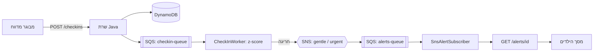

מושך# Care Circle

מערכת לניטור בריאות משפחתי. היא לומדת את ההרגלים היומיומיים של כל אדם (שעת קימה, שעות שינה, ארוחות), מזהה חריגה לפי z-score אישי, ושולחת התראה לילדים כשיש חשד לאירוע.

פרויקט גמר בקורס **"מקוד לענן"** (Java · LocalStack · Docker · CI/CD).

---

## איך זה עובד



1. מבוגר מדווח על ערך (למשל שעת קימה). השרת שומר ב-DynamoDB ושולח הודעה לתור SQS.
2. `CheckInWorker` מושך מהתור, ושומר היסטוריה לכל `אדם:סוג`. מ-3 דגימות ומעלה הוא מחשב `z = |ערך − ממוצע| / סטיית תקן`.
3. `|z| > 2` מייצר התראה **עדינה**, `|z| > 3` התראה **דחופה**, והיא מתפרסמת ב-SNS.
4. SNS מעביר אותה לתור `alerts-queue`, ו-`SnsAlertSubscriber` שומר אותה כדי שהילדים יראו אותה.

---

## עמידה בדרישות הקורס

| דרישה | מימוש |
|---|---|
| שרת Java | Java 17 נקי (`com.sun.net.httpserver`), בלי framework. Maven, Gson |
| 2+ שירותי AWS דרך LocalStack | **DynamoDB** (אנשים וצ'ק-אינים), **SQS** (שני תורים), **SNS** (שני נושאים) |
| Docker Compose | `docker/docker-compose.yml`: LocalStack ואפליקציה, עם healthcheck ו-`depends_on` |
| טסטים | JUnit 5, 5 טסטים (`make test`), רצים בלי LocalStack |
| CI | GitHub Actions: `mvn verify` ובניית אימג' Docker על כל push ו-PR |
| README ציבורי | הקובץ הזה |
| בונוס UI | ממשק web בשלושה מסכים: פתיחה, מבוגרים, ילדים |

---

## הרצה

דרישות: Docker, ולפיתוח: Java 17 ו-Maven.

```bash
make docker-up
```

- הממשק: http://localhost:8080
- הטבלאות, התורים והנושאים נוצרים אוטומטית (`docker/init-localstack.sh`).
- עצירה: `make docker-down`.

פקודות נוספות: `make build`, `make test`, `make run`.

### בדיקה מהירה של הזרימה
1. פתח http://localhost:8080 ← **מבוגרים** ← הירשם ← פתח "הדגמה" ולחץ "הרץ הדגמה".
2. העתק את "הקוד שלי לשיתוף".
3. פתח את מסך **ילדים**, הדבק את הקוד. אחרי כחצי דקה תופיע התראה.

---

## API

| Method | Path | תיאור |
|---|---|---|
| GET | `/health` | בדיקת חיות |
| POST | `/people` | יצירת אדם `{"name","circleId"}` |
| GET | `/people/{id}` | שליפת אדם |
| POST | `/checkins` | דיווח `{"personId","type","value"}` |
| GET | `/alerts/{personId}` | התראות של אדם |
| GET | `/` | הממשק |

---

## מבנה הפרויקט

```
src/main/java/com/carecircle/
  Main.java            השרת וה-endpoints
  model/               Person, CheckIn, Alert
  store/               PeopleStore, CheckInStore (DynamoDB), AlertStore, InMemory* (לטסטים)
  service/             SqsService, SnsService
  worker/              CheckInWorker, SnsAlertSubscriber (threads ברקע)
src/main/resources/static/index.html   הממשק
src/test/java/com/carecircle/          הטסטים
docker/                docker-compose.yml, init-localstack.sh
Dockerfile, Makefile, .github/workflows/ci.yml
```

---

## בדיקות

שלוש מחלקות טסט (Health, People, CheckIn). כל טסט מרים שרת אמיתי על פורט ייעודי (8081-8083) ושולח אליו בקשות HTTP אמיתיות.

כדי שהטסטים לא יהיו תלויים ב-LocalStack, `Main.createServer` מקבל Stores מבחוץ, והטסטים מזריקים גרסאות בזיכרון (`InMemoryPeopleStore`, `InMemoryCheckInStore`).

---

## איך נבנה הפרויקט, ומה נעשה בעזרת AI

הפרויקט נבנה כולו בעזרת Claude (Anthropic), כפי שהקורס התיר. ההבדל הוא באופן העבודה בשני שלבים.

### שלב א': בנייה בלמידה (16.7.2026 עד 31.10.2026)
בניתי את הפרויקט שלב אחרי שלב. בכל שלב קיבלתי מדריך PDF מפורט עם הסבר שורה-שורה, הקלדתי את הקוד בעצמי, הרצתי ותיקנתי תקלות:

1. **שלד:** שרת `/health`, Maven (`pom.xml`), `Makefile`.
2. **Endpoints ובדיקות:** `POST /people`, `GET /people/{id}`, `POST /checkins`, ה-Stores בזיכרון, וטסטים עם JUnit 5.
3. **DynamoDB:** מעבר מ-HashMap ל-DynamoDB מול LocalStack.
4. **SQS:** שליחת צ'ק-אין לתור.
5. **Worker ו-SNS:** `CheckInWorker`, חישוב z-score, `SnsAlertSubscriber`.
6. **Docker ו-CI:** Dockerfile, Compose, GitHub Actions.

בשלב הזה למדתי את המושגים: threads ו-`HttpServer`, Maven, Docker multi-stage, LocalStack, ו-GitHub Actions עם branch protection.

### שלב ב': השלמה בעזרת Claude (מ-31.10.2026)
בגלל איחור גדול והלחץ להגיש, ביקשתי מ-Claude לכתוב את הקוד כקבצים מלאים שאני מעתיק ומדביק. נכנסתי לשלב 6 ולבדיקות, כשהמערכת הייתה בנויה בחלקה. מה ש-Claude עשה:

| תחום | מה נעשה |
|---|---|
| **טסטים** | זיהה שהטסטים נכשלים כי ה-Stores פונים ל-DynamoDB בלי LocalStack. הוסיף `InMemory*Store` ועמיסת-יתר ל-`createServer`. |
| **שרת** | תיקון קריאה ל-SQS שהפילה את הבקשה (`try/catch`), הגשת הממשק מ-`/`, ותיקון קידוד UTF-8 בתשובות. |
| **Docker** | Dockerfile, שירות האפליקציה ב-Compose, `init-localstack.sh` (טבלאות, תורים, נושאים, מנויים), והמתנה לסיום ה-init דרך healthcheck. |
| **חיבור לענן המקומי** | קריאת `LOCALSTACK_ENDPOINT` ב-Stores, `SqsService` ו-`SnsService` (במקום `localhost` קבוע שלא עובד בתוך קונטיינר), וכינוי רשת לכתובות התורים. |
| **CI** | `ci.yml` עם שלב בניית Docker. |
| **ממשק (בונוס)** | שלושה מסכים, מסך פתיחה מונפש ואפקטים. |
| **תיעוד** | ה-README הזה. |
| **דיבוג** | זיהוי טעויות כמו שם קובץ שגוי (`SnsAlrtSubscriber.java`), ועדכון קבצים שלא נשמרו. |

### תקלות שנתקלתי בהן (ומה למדתי)
- jar ישן ב-`target/`: הפתרון `mvn clean`.
- LocalStack `latest` דורש רישיון: נעצרתי על גרסה 3.8.1.
- LocalStack 0.14.5 לא תואם ל-AWS CLI החדש ("Missing Action").
- `docker` לא נמצא ב-WSL: הפעלת אינטגרציית WSL ב-Docker Desktop.
- כתובת קבועה `localhost:4566` שלא עובדת בתוך קונטיינר.
- האפליקציה עלתה לפני שה-init יצר את התורים (race): הוסר עם healthcheck שמחכה לסיום ה-init.
- SQS רגיל לא שומר על סדר, ולכן בדיקות הדגמה צריכות להמתין בין הדגימות.

---

## מגבלות ידועות

- **ההתראות נשמרות בזיכרון** (`AlertStore`) ולכן נעלמות באתחול האפליקציה. אנשים ודיווחים נשמרים ב-DynamoDB, ובאתחול של LocalStack גם הם מתאפסים.
- **חומרת ההתראה בהדגמה היא "עדינה"** גם עבור חריגה גדולה. ההשערה: הערך החדש נכנס להיסטוריה לפני חישוב ה-z-score ומקטין אותו. נדרש תיקון ב-`CheckInWorker`.
- **ברשימת המעקב של הילדים** אין endpoint שמחזיר את כל האנשים, ולכן הרשימה נשמרת בדפדפן.
- אין אימות משתמשים; מדובר בסביבת לימוד מקומית.
- המערכת **אינה כלי רפואי**: היא מזהה שינוי בדפוסים בלבד.
